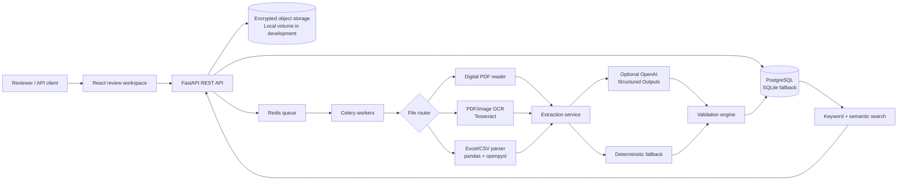
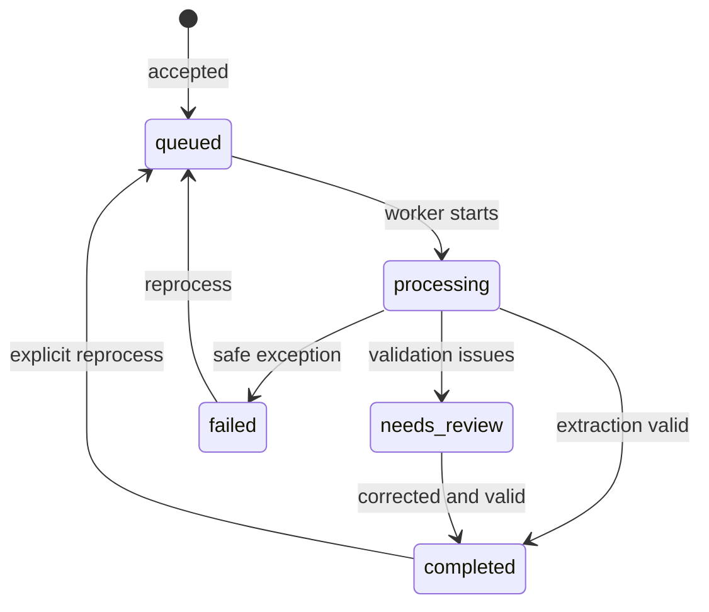

# Architecture

## Processing state machine

The API never performs long OCR synchronously when Celery mode is enabled. Development mode uses FastAPI background tasks to minimize setup. A stage event is written at upload, parse, extract, validate, and failure boundaries.

For 1000-page PDFs, the current worker extracts/rasterizes sequentially. A production evolution can fan out page ranges into child jobs, merge text in page order, and apply backpressure per tenant.

