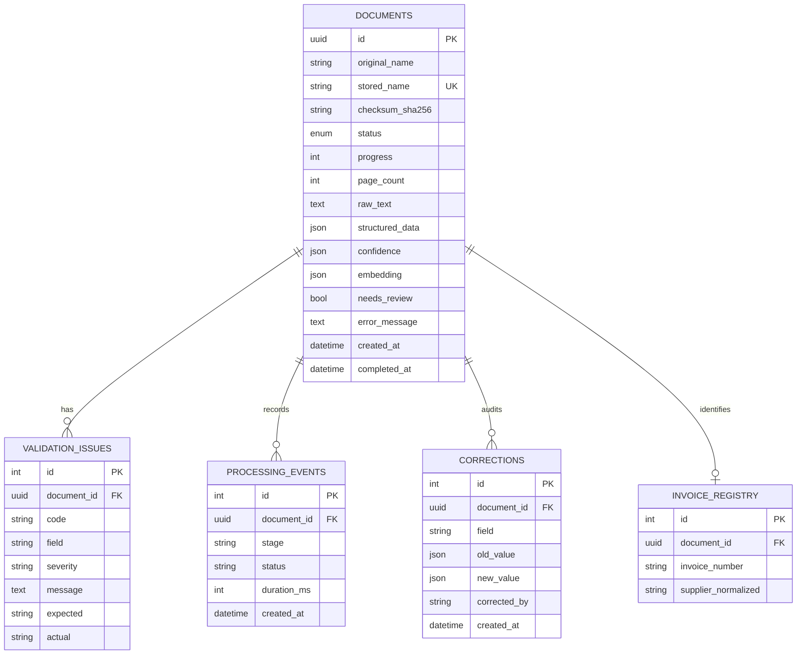

# Database schema

`(invoice_number, supplier_normalized)` is unique for durable duplicate detection. Structured results remain JSON for evolution; operational filters use first-class columns. For production vector search, migrate `embedding` from JSON to `vector(n)` with a pgvector HNSW index.

